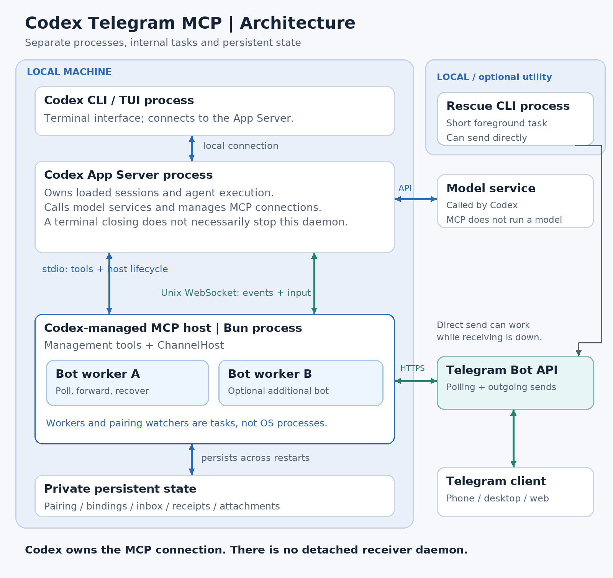
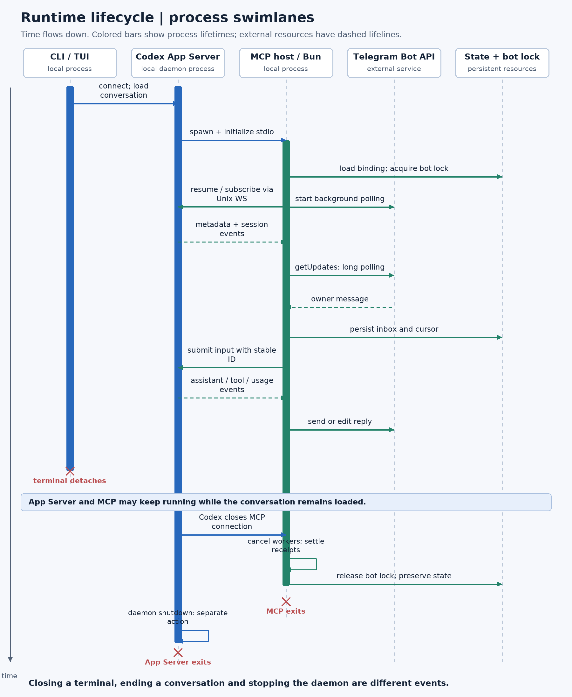
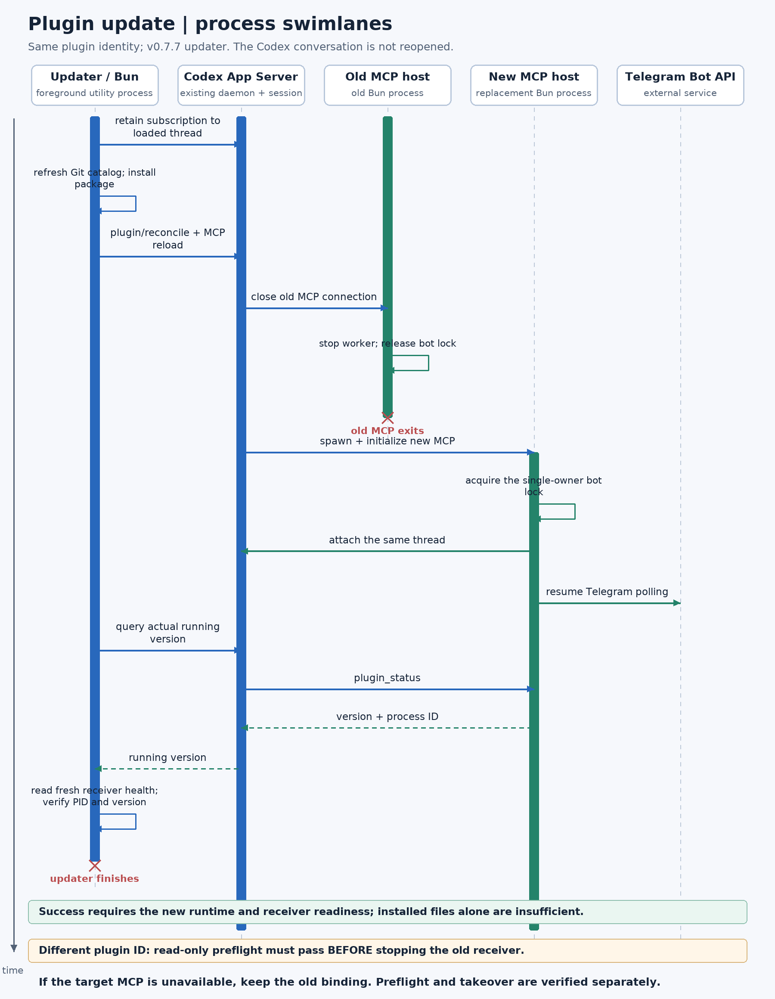

# Architecture and lifecycles

[Development](development.md) · [Runtime reference](runtime.md) · [README](../README.md)

## Runtime structure

The terminal UI, Codex App Server and Bun MCP host are separate processes.
The App Server owns sessions and model execution. Codex owns the MCP connection;
closing or replacing that connection shuts down the host's tasks.

`ChannelHost` owns bot workers and their senders. Workers are asynchronous tasks
inside the MCP process, not independently supervised processes. Each bot has an
operating-system lock, so a replacement must wait for the previous poller to stop.
Pairing uses a temporary watcher that ends on confirmation, cancellation or expiry.

Two connections serve different purposes: stdio exposes MCP tools to Codex, while
local Unix WebSocket RPC submits Telegram input and observes session events.
Telegram polling and sends use HTTPS. Pairing, bindings, inbox and delivery
receipts persist outside the process. Unknown sends are never blindly replayed.

The rescue CLI is a short foreground process using the same state and receipts.
It can send a message when normal receiving is unavailable. A successful direct
send does not prove the worker or automatic forwarding is working.

## Lifecycles

| Component | Starts when | Stops when |
| --- | --- | --- |
| Terminal UI | The user opens or attaches Codex | The user closes or detaches it |
| App Server | Codex starts its server/daemon | The server is shut down; one terminal closing need not stop it |
| MCP host | Codex initializes the configured plugin connection | Codex closes or replaces the connection, or disables/removes the plugin |
| Bot worker | Its bound session authorizes connection and the bot lock is acquired | Pause, disable, binding change, session closure, or host shutdown |
| Pairing watcher | A pairing window opens | Confirmation, cancellation, expiry, or host shutdown |
| Rescue CLI | A user or agent invokes a documented foreground command | That command finishes |

Transport failures can reconnect within the same MCP process. By contrast,
replacing the MCP host cancels its workers and requires a new host to acquire
the bot lock and attach to Codex. Pausing one bot leaves other bot workers alone.

## Updates and identity changes

The update and handoff safeguards shown here are available starting in v0.7.7. The same-identity updater has been tested against a real,
isolated Codex session without reopening it; that probe does not verify Telegram
delivery or prove that a newly introduced MCP server can hot-load into any session.

A same-identity update retains a subscription to loaded conversations, installs
new files, requests MCP refresh and checks the actual running version and receiver
health. An accepted refresh request alone is insufficient.

An identity handoff checks the target plugin ID and read-only tool dispatch before
stopping an existing receiver or changing its installation binding. This check
must not start another poller. The old worker then releases the bot lock before
the new worker starts. Attachment and verified takeover are recorded separately.
If the target is unavailable, keep the existing binding. If receiving is already
down, use the durable send path for one actionable notice, preserving unknown
receipts. Never automatically archive or reopen an active conversation.
